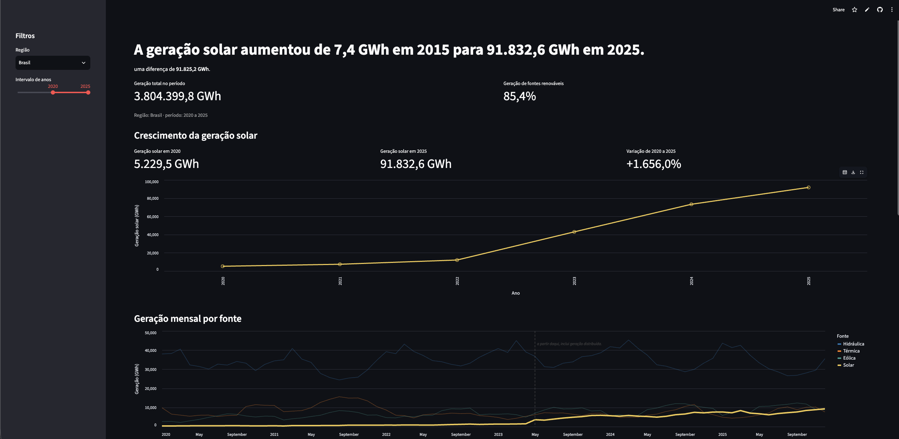

# Explorador de Energia

Aplicativo interativo feito com Streamlit para explorar como mudou a geração de energia elétrica no Brasil entre 2015 e 2025. O painel apresenta a geração mensal por fonte, destaca a evolução da energia solar e permite filtrar os dados por região e período.

## Pergunta que o app responde

Como a geração de energia no Brasil — e, em especial, a geração solar — mudou de 2015 a 2025?

## Principal conclusão

No conjunto de dados, a geração solar anual passou de **7,4 GWh em 2015** para **91.832,6 GWh em 2025**, uma diferença de **91.825,2 GWh**. Esses valores mostram o crescimento da geração solar no período; por si só, não explicam suas causas.

## Fonte dos dados

Os dados são do conjunto [Balanço de Energia nos Subsistemas, do ONS](https://dados.ons.org.br/dataset/balanco-energia-subsistema), disponível no portal de Dados Abertos do Operador Nacional do Sistema Elétrico. O conjunto inclui geração por fonte e carga nos subsistemas. Licença: [CC BY](https://creativecommons.org/licenses/by/4.0/).

O arquivo `energia_ons_mensal.csv` incluído no projeto contém os dados usados pelo app, organizados por ano, mês e subsistema. A atribuição da fonte é exibida também no rodapé do painel.

## Como executar

Requisitos: Python e `pip`.

1. Clone ou baixe este repositório e acesse a pasta do projeto.
2. Instale as dependências:

   ```bash
   pip install -r requirements.txt
   ```

3. Inicie o aplicativo:

   ```bash
   streamlit run app.py
   ```

O app lê automaticamente o arquivo `energia_ons_mensal.csv` localizado na pasta do projeto.

## App publicado

[https://explorador-de-energia-zcbz4tjnv74ujhssfnniqs.streamlit.app/](#)

## Captura de tela

Adicione uma imagem do painel ao projeto e atualize o caminho abaixo:


